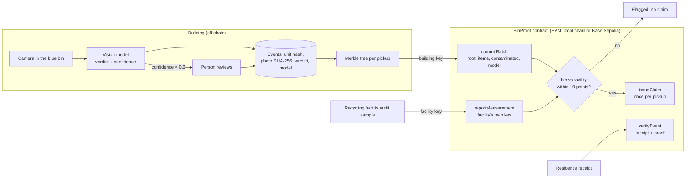

# BinProof

**Recycling contamination, recorded at the bin, checked by the facility, claimable once.**

IEEE ClimateChain Global Hackathon 2026 · **Track: Sustainable Supply Chains** ("Recycling traceability systems", "Circular economy incentive platforms").

## The problem

- Toronto's audited Blue Box contamination in 2025 was **35.4%**, which Circular Materials calls "one of the highest rates in Ontario" ([City of Toronto, 2026](https://www.toronto.ca/legdocs/mmis/2026/ie/bgrd/backgroundfile-286376.pdf)).
- In apartments and condos, hundreds of units share one bin. Toronto's multi-unit diversion was **27%** against **65%** for houses, and it's "harder to hold residents accountable" ([Waste Dive](https://www.wastedive.com/news/toronto-targets-multi-unit-buildings-to-reach-70-diversion/425002/)). Truck cameras that trace contamination stop at the address, and a tower is one address.
- Ontario's producers now pay for recycling and trade recovered tonnes as credits, but in December 2025 the Auditor General found the regulator "has not begun to enforce" audits of the performance data, and nobody clearly owns verifying the credits ([Auditor General of Ontario](https://www.auditor.on.ca/en/content/annualreports/arreports/en25/pa_RPRA_en25.pdf), sections 4.2.1 and 4.2.2). Every number is reported by someone who is paid by it.
- Where cities have tied waste to people, they've done it by watching them: bag inspections, photos of carts, postcards. Residents push back ("Trash is really personal").

## What BinProof does

1. **The bin sees.** A camera in a shared blue bin photographs each item. A vision model decides if it belongs and how sure it is. Low-confidence verdicts go to a person and never count against anyone until they're checked.
2. **Only a fingerprint is kept.** Each disposal becomes an event: the unit as a salted hash (never a name), the photo's SHA-256 (never the photo), the verdict, the confidence and the model that made it.
3. **The building commits each pickup.** A pickup closes the open events into a Merkle tree, and the building's key commits the root, the counts and the model ID on chain.
4. **The facility checks it, with its own key.** The recycling facility signs the contamination it measured in that load. The contract compares the two: within 10 points, the pickup is **Verified**; otherwise it's **Flagged**.
5. **One verified pickup, one claim.** A diversion claim can be issued once per verified pickup. A second claim is refused by the contract (`AlreadyClaimed`), so the same tonnes can't be counted twice.
6. **Anyone can check a receipt.** A resident's receipt holds their event and a Merkle proof. The contract's `verifyEvent` confirms it's inside the committed pickup without revealing anyone else's items. Change one field and it fails.

## Architecture



| Piece | File |
|---|---|
| Contract | [`contracts/BinProof.sol`](contracts/BinProof.sol) |
| Vision verdict (on-device Ollama, or Gemini for the hosted demo) | [`src/vision.js`](src/vision.js) |
| Events, Merkle batching, receipts | [`src/ledger.js`](src/ledger.js) |
| Chain calls and the two signers | [`src/chain.js`](src/chain.js) |
| Web app and API | [`server.js`](server.js) (Node) or [`backend-java/`](backend-java) (Spring Boot), [`frontend/index.html`](frontend/index.html) |

## Security and data integrity

| Data | Where it lives |
|---|---|
| The photo | On the bin's device only. The hosted demo sends it to Gemini for the verdict and discards it. |
| Photo SHA-256, verdict, confidence, model, time | Off-chain event, and inside the pickup's Merkle root |
| Unit | A salted hash. The building holds the salt; outsiders can't reverse it. |
| Merkle root, item count, contamination count, model ID | On chain, signed by the building key |
| Facility measurement | On chain, signed by the facility key |
| Building totals | Public. Individual items are visible only to the resident holding the receipt. |

- **Two keys, two parties.** The contract accepts a batch only from the building's address and a measurement only from the facility's. In the hosted demo, one server holds both keys so judges can play both roles. In a real deployment, the facility signs from its own system.
- **The chain makes the AI's claim tamper-evident, not correct.** That's why the model ID and confidence are recorded, low-confidence verdicts go to a person, and an independent measurement decides whether anything can be claimed.
- **What's never recorded:** faces (the camera points into the bin), names, photos on any public system.
- **Known limits:** people can dump without scanning; the camera sees the top of an item, not inside a bag; a building and a facility that collude can still lie together; a facility's figure is extrapolated from a sample; a unit hash is still personal data to the building that holds the salt.

## Hardware: software first, the bin comes next

We're two broke college students, so we built the software part of the product first, not the bin. BinProof runs on any camera that can see what goes into a shared bin. We tested it with a webcam and real items.

For anyone who wants to build one, a reference parts list (not built; PiShop.ca prices, Oct 25, 2026, before tax):

| Part | CAD |
|---|---|
| Raspberry Pi 5, 8 GB | 249.50 |
| Camera Module 3 | 36.45 |
| 27 W power supply | 16.95 |
| Active cooler | 7.15 |
| 32 GB microSD | 28.95 |
| MG996R servo (lid) | 8.65 |
| **Electronics total** | **347.65** |

Not included: the lid or tray, mounting, wiring, a separate servo supply. About 3 W idle and 8.8 W at full load.

Honest limit: Google's own Raspberry Pi 5 numbers for Gemma 4 E4B are about 20 seconds to the first token, for text alone. So on this board a small, fast classifier would decide whether the lid opens, and the vision model would write the record afterwards.

## Impact projection (assumptions stated)

These are assumptions to make the scale concrete, not measured results from BinProof.

- A 300-unit tower, about 5 kg of blue-bin material per unit a week: about **1.5 tonnes a week**.
- At Toronto's 35.4%, about **530 kg a week** of that is contamination.
- Feedback at the source has cut contamination by about **23%** against a control group before (East Lansing's truck-camera postcards, [The Sun](https://www.the-sun.com/news/12727498/artificial-intelligence-garbage-trucks-technology-east-lansing-michigan/)). Applied here, about **120 kg a week** less contamination per tower, roughly 6 tonnes a year, without photographing anyone.
- The verification side scales with the producer system: every verified pickup is one claim that can't be counted twice.

## Run it

**Local (on-device model, local chain):** needs Node 20.12+ and [Ollama](https://ollama.com) with a vision model (`ollama pull gemma4:e4b-it-qat`).

```bash
npm install
npx hardhat compile
npm start
```

Open http://localhost:3030. `npm start` starts a local chain, deploys the contract, adds 24 seeded events from other units (labelled **seeded** everywhere), and serves the app.

**Spring Boot backend (Java):** the same API and the same web page, in [`backend-java/`](backend-java). Start the local chain and contract first with `npm start` (it also seeds the demo), then in another terminal:

```bash
cd backend-java
mvn -DskipTests package
java -jar target/binproof-backend-1.0.0.jar
```

Open http://localhost:8080. It reads the same `data/` folder and `deployment.json`, builds the same OpenZeppelin-compatible Merkle trees (receipts from either backend verify on chain), and signs as the building and the facility with web3j.

**Testnet (Base Sepolia):** `npm run wallets` makes two testnet-only wallets in `.env`. Fund the building wallet with Base Sepolia test ETH, then `npm run deploy:testnet`. Set `BINPROOF_VISION=gemini` and `GEMINI_API_KEY` to use Gemini, and `npm run serve`.

**Hosted demo:** [`render.yaml`](render.yaml) deploys the web app on Render's free tier. It runs its own local chain inside the service and deploys the contract on start, so it needs no testnet funds; the trade-off is that its chain resets when the service restarts and has no public explorer. The only secret is `GEMINI_API_KEY`, set in the Render dashboard.

## Honest notes

- Seeded events stand in for a building's other residents. They're marked `seeded: true` in the Merkle leaf itself, on the page, and in this README.
- The facility measurement in the demo is typed in, standing in for an audit sample.
- The 10-point tolerance is a demo setting, fixed at deploy time.

## License

MIT
