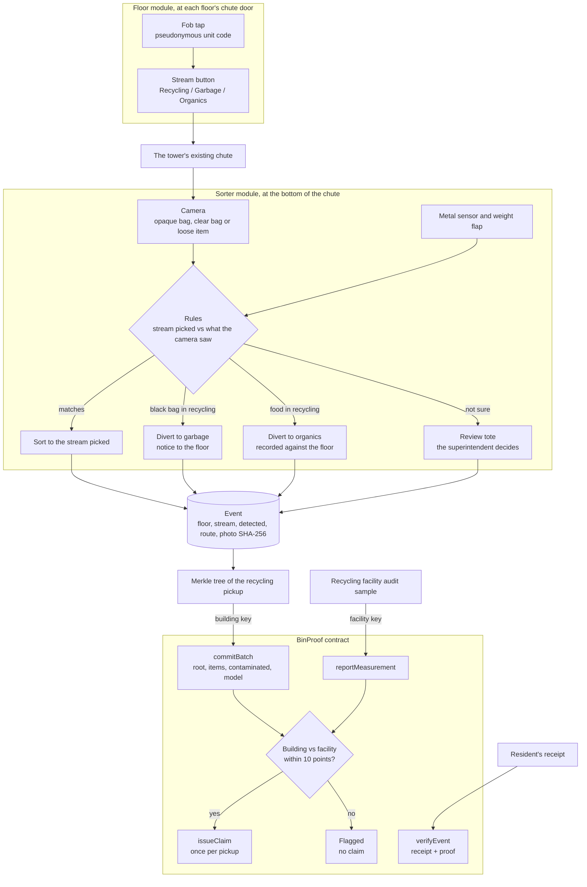

# BinProof

**BinProof clips onto the chute sorter a tower already has. Every drop checked, every pickup verified by the facility, claimable once.**

IEEE ClimateChain Global Hackathon 2026 · **Track: Sustainable Supply Chains** ("Recycling traceability systems", "Circular economy incentive platforms").

## The problem

- In Toronto towers, residents don't carry recycling to a bin. They drop it down the **garbage chute** on their floor. The Toronto Green Standard requires new towers to have a sorting system, and "a single chute with a tri-sorter" is one of the approved options: a button at each floor's chute door picks Recycling, Garbage or Organics, and a sorter at the bottom routes the drop ([TGS v3, SW 1.1](https://www.toronto.ca/city-government/planning-development/official-plan-guidelines/toronto-green-standard/toronto-green-standard-version-3/mid-to-high-rise-residential-all-non-residential-version-3/solid-waste-for-mid-to-high-rise-residential-all-non-residential/)).
- Apartments recycle far less than houses. The City's 2025 diversion rate was **26.3%** for multi-residential buildings and **60.3%** for single-family homes ([City of Toronto, solid waste reports](https://www.toronto.ca/services-payments/recycling-organics-garbage/solid-waste-reports/)).
- Toronto's audited Blue Box contamination in 2025 was **35.4%**, which Circular Materials calls "one of the highest rates in Ontario" (Circular Materials data in a [City of Toronto committee file, 2026](https://www.toronto.ca/legdocs/mmis/2026/ie/bgrd/backgroundfile-286376.pdf)).
- Since January 2026, producers pay for that recycling through Circular Materials. In December 2025, Ontario's Auditor General found the regulator "has not begun to enforce" audits of the performance data ([Auditor General of Ontario](https://www.auditor.on.ca/en/content/annualreports/arreports/en25/pa_RPRA_en25.pdf), sections 4.2.1 and 4.2.2). Every number is reported by someone who is paid by it.
- A tower is one address. Nobody can see which floor contaminated the load, so nothing changes. Nobody checks what happens after the button.

## What BinProof does

1. **At the chute door (floor module).** The resident taps a fob and presses the stream button. BinProof logs the floor, the stream they picked, and a pseudonymous code for the unit.
2. **At the bottom of the chute (sorter module).** A camera checks the drop against the stream that was picked. A vision model describes it (closed opaque bag, clear bag or loose item, and what it's made of), and a rules table decides. A metal sensor and a weight flap add evidence.
3. **Sorted, diverted, or sent to review.** The drop goes to the stream that was picked, gets diverted (a black bag **to garbage**, visible food **to organics**), or goes to the **review tote** for the superintendent. Every drop is recorded with its floor, stream, what the camera saw, and where it went. The photo stays on the device; only its SHA-256 is kept.
4. **The building commits each pickup.** A pickup closes the recycling drops into a Merkle tree, and the building's key commits the root, the counts and the model ID on chain.
5. **The facility checks it, with its own key.** The recycling facility signs the contamination it measured in that load. Within 10 points of the building's number, the pickup is **Verified**; otherwise it's **Flagged**.
6. **One verified pickup, one claim.** A diversion claim can be issued once per verified pickup. A second claim is refused by the contract (`AlreadyClaimed`), so the same tonnes can't be counted twice.
7. **Anyone can check a receipt.** A receipt holds one drop and its Merkle proof. The contract's `verifyEvent` confirms it's inside the committed pickup without revealing anyone else's drops. Change one field and it fails.

### The black bag question

**We don't need to see inside the bag.** Circular Materials tells Toronto residents "Do not bag your recyclables" ([Circular Materials, Toronto](https://www.circularmaterials.ca/toronto)), so **a closed opaque bag in the recycling stream is itself the contamination.** The sorter diverts it to garbage and the floor gets a notice. Organics may go down in a bag, so the bag rule applies only to recycling.

What we can't see is recyclables hidden in black bags sent down as garbage. We don't claim to measure that. We measure how clean the recycling stream is, which is the number producers pay for.

### The compost question

Food the camera can see in the recycling stream is diverted to organics and recorded against the floor. Food it can't see, like a yogurt cup that still has yogurt in it or grease inside a closed box, passes the camera. **The facility's measurement catches it**: the facility measures the real load, so hidden food makes its number higher than the building's. If the gap is more than 10 points, the pickup is **Flagged** and nothing can be claimed. The camera catches what it can see. The facility catches the rest. If they disagree, nothing gets claimed.

| Stream picked | What the sorter sees | Route |
|---|---|---|
| Garbage | anything | garbage |
| Recycling | closed opaque bag | **diverted to garbage**, floor notice |
| Recycling | not sure, or low confidence | **review tote** |
| Recycling | food it can see | **diverted to organics**, recorded against the floor |
| Recycling | loose or clear-bag item | recycling (contamination recorded against the floor if it doesn't belong, including a container with food left in it) |
| Organics | metal hit, or unusually heavy | **review tote** |
| Organics | anything else | organics |

The model describes, the rules decide. The table lives in [`Vision.java`](backend-java/src/main/java/binproof/Vision.java) (`decide`).

### Related work

AI at the bin already sells. [Oscar Sort](https://intuitiveai.ca/oscar-sort) (Intuitive AI) retrofits existing public bins with a camera and a screen that tell people which bin their item goes in. That works where a person stands at a bin. In a tower, nobody stands at a screen: they drop it down the chute on their floor. BinProof goes in the chute, checks what actually landed, and has a second party sign the numbers.

## Architecture



| Piece | File |
|---|---|
| Contract | [`contracts/BinProof.sol`](contracts/BinProof.sol) |
| Backend (Spring Boot): the API | [`ApiController.java`](backend-java/src/main/java/binproof/ApiController.java) |
| Vision verdict and the routing rules | [`Vision.java`](backend-java/src/main/java/binproof/Vision.java) |
| Drops, pickups, review, receipts | [`Ledger.java`](backend-java/src/main/java/binproof/Ledger.java) |
| OpenZeppelin-compatible Merkle trees | [`Merkle.java`](backend-java/src/main/java/binproof/Merkle.java) |
| Chain calls and the two signers (web3j) | [`Chain.java`](backend-java/src/main/java/binproof/Chain.java) |
| Website (React) | [`frontend/index.html`](frontend/index.html) |
| Local chain, deploy, seeded drops | [`scripts/`](scripts), [`hardhat.config.js`](hardhat.config.js) |

## Hardware: software first, the kit comes next

We're two broke college students, so we built the software part of the product first, not the hardware. We tested the software with a laptop webcam and real items. In the demo, the floor panel, the metal sensor and the weight flap are simulated inputs, and the page labels them that way.

The kit is two small modules that clip onto the chute a tower already has. No new chute, no new bins.

- **Floor module:** a fob reader at each floor's chute door that logs the stream button press. Many towers already have the button. Cost per floor: [NEEDS SOURCE].
- **Sorter module:** a camera and a small computer at the bottom of the chute, with an inductive metal sensor and a load cell under a catch flap.

Reference parts for the sorter's computer and camera (not built; PiShop.ca prices, Oct 25, 2026, before tax):

| Part | CAD |
|---|---|
| Raspberry Pi 5, 8 GB | 249.50 |
| Camera Module 3 | 36.45 |
| 27 W power supply | 16.95 |
| Active cooler | 7.15 |
| 32 GB microSD | 28.95 |
| **Subtotal** | **339.00** |
| Inductive metal sensor, load cell, catch flap, fob readers | [NEEDS SOURCE] |

Honest limit: Google's own Raspberry Pi 5 numbers for Gemma 4 E4B are about 20 seconds to the first token, for text alone. A drop falls in about a second. So in the chute, a small, fast classifier would route the drop, and the vision model would write the record afterwards.

## Security and data integrity

| Data | Where it lives |
|---|---|
| The photo | On the sorter's device only. Only its SHA-256 is recorded. |
| Unit | Pseudonymous: a salted hash of the fob. The building holds the salt. Residents get floor-level feedback. |
| Floor, stream, what the camera saw, route, sensor readings and where each reading came from | Off-chain event, and inside the pickup's Merkle root |
| Merkle root, item count, contamination count, model ID | On chain, signed by the building key |
| Facility measurement | On chain, signed by the facility key |
| Building totals | Public. A single drop is visible only to whoever holds its receipt. |

- **Two keys, two parties.** The contract accepts a batch only from the building's address and a measurement only from the facility's. In the demo, one backend holds both keys so judges can play both roles. In a real deployment, the facility signs from its own system.
- **The chain makes the AI's claim tamper-evident, not correct.** That's why the model ID and confidence are recorded, unsure drops go to a person, and an independent measurement decides whether anything can be claimed.
- **The camera sees waste, not people.** It points at the bottom of the chute. No faces, no names, no photos on any public system.
- **Known limits:** food hidden inside a container passes the camera (the facility's measurement catches it, and the pickup flags); people can skip the chute and carry bags down; without fobs, attribution is floor-level only; we can't see recyclables hidden inside garbage bags; a building and a facility that collude can still lie together; the facility's figure is extrapolated from a sample; a unit hash is still personal data to the building that holds the salt; v1 needs a tower with a stream choice (a tri-sorter or separate chutes). How many Toronto towers have one: [NEEDS SOURCE].

## Impact projection (assumptions stated)

These are assumptions to make the scale concrete, not measured results from BinProof.

- A 300-unit tower, about 5 kg of recycling-stream material per unit a week: about **1.5 tonnes a week**.
- At Toronto's 35.4%, about **530 kg a week** of that is contamination.
- Feedback at the source has cut contamination by about **23%** against a control group before (East Lansing's truck-camera postcards, [The Sun](https://www.the-sun.com/news/12727498/artificial-intelligence-garbage-trucks-technology-east-lansing-michigan/)). Applied here, about **120 kg a week** less contamination per tower, roughly 6 tonnes a year, with floor-level feedback instead of photos of anyone.
- The verification side scales with the producer system: every verified pickup is one claim that can't be counted twice.

## Run it

Needs Node 20.12+, Java 21+, Maven, and [Ollama](https://ollama.com) with a vision model (`ollama pull gemma4:e4b-it-qat`).

**1. The local chain.** Starts a Hardhat chain, deploys the contract, and adds seeded drops from other floors (labelled **seeded** everywhere):

```bash
npm install
npx hardhat compile
npm start
```

**2. The backend (Spring Boot), in a second terminal:**

```bash
cd backend-java
mvn -DskipTests package
java -jar target/binproof-backend-1.0.0.jar
```

Open http://localhost:8080. Spring Boot serves the website from `frontend/` and the API under `/api`.

**Testnet (Base Sepolia):** `npm run wallets` makes two testnet-only wallets in `.env`. Fund the building wallet with Base Sepolia test ETH and run `npm run deploy:testnet`. Then start the backend with `BUILDING_KEY` and `FACILITY_KEY` set to those wallets' keys, and `--binproof.rpc=https://sepolia.base.org`.

## Honest notes

- Seeded drops stand in for a building's other residents. They're marked `seeded: true` in the Merkle leaf itself, on the page, and in this README.
- The floor panel, metal sensor and weight flap are simulated in the demo. The camera's verdict is real, from a vision model running on the laptop.
- The facility measurement in the demo is typed in, standing in for an audit sample.
- The 10-point tolerance is a demo setting, fixed at deploy time.

## License

MIT
